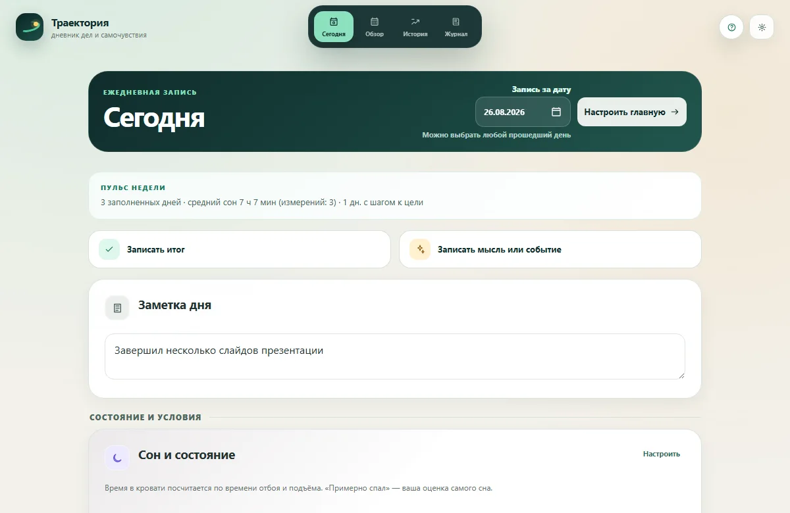
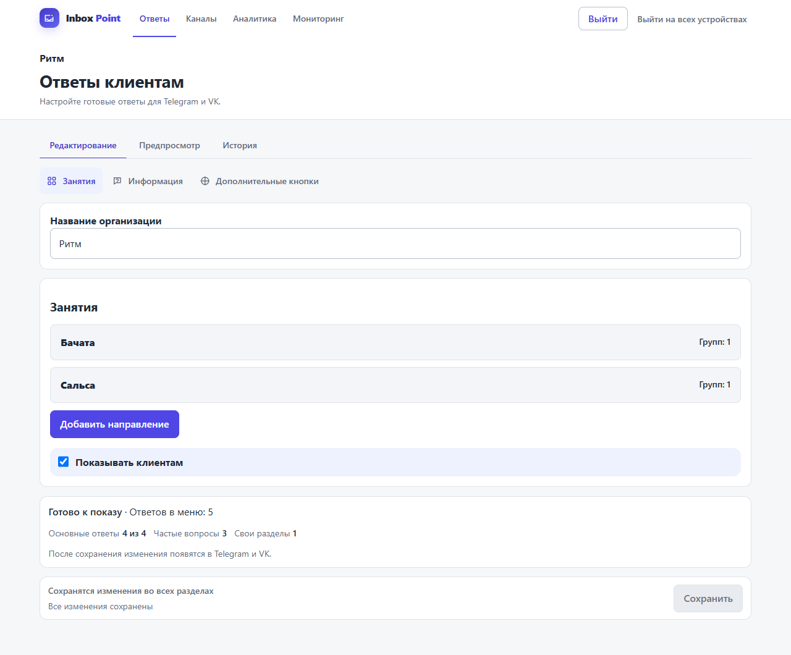
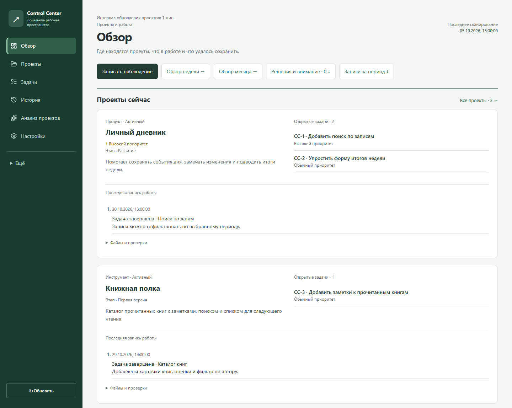
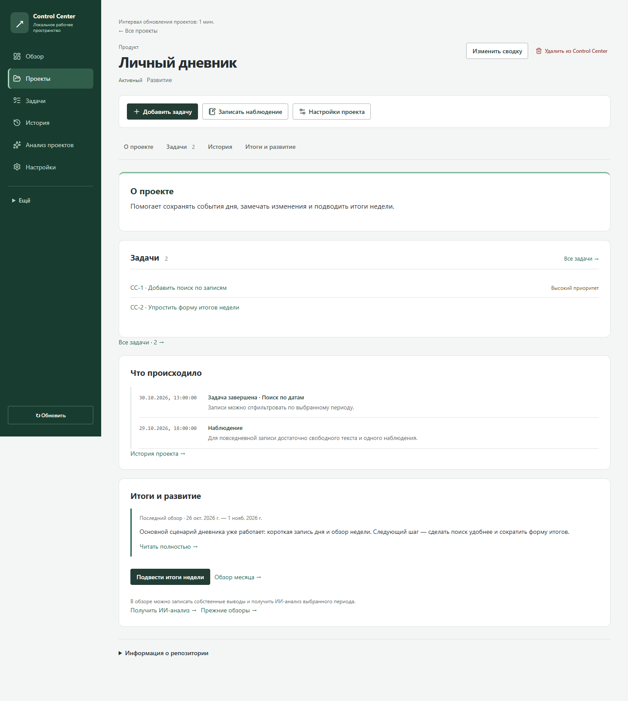

# Dmitry Afonasenko

I'm a frontend developer working with Vue, React, and TypeScript.

## Applications

### Trajectory

A personal journal for daily notes, weekly and monthly reviews, and exploring changes over time. It works offline and syncs records across devices.

[Open the app](https://trajectory-life.ru) · [Source code](https://github.com/Dmitryaf/trajectory-life)

Vue 3 · TypeScript · Pinia · Dexie · Supabase

### Inbox Point

A customer messaging service. Customers write through Telegram or VK, staff reply in Telegram, and answers return to the original conversation. A web interface lets staff manage schedules, prices, and FAQs, and check the service's status.

[Source code](https://github.com/Dmitryaf/inbox-point)

React · TypeScript · Node.js · Fastify · SQLite

### Control Center

A local app for tracking projects, tasks, decisions, and weekly or monthly reviews.

[Source code](https://github.com/Dmitryaf/control-center)

The screenshots use demonstration data.

## Development Tools

### [Agent Engineering Kit](https://github.com/Dmitryaf/agent-engineering-kit)

Engineering guidelines and focused skills for working with AI coding agents. Covers code changes, data safety, service reliability, user interfaces, and parallel work.

Markdown · AGENTS.md · Skills

## Contact

[Telegram · @dmitry_tbp](https://t.me/dmitry_tbp)
