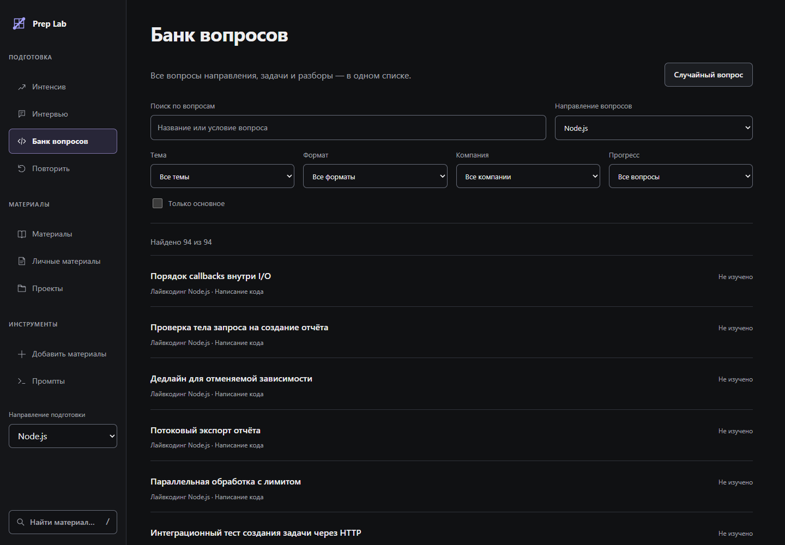
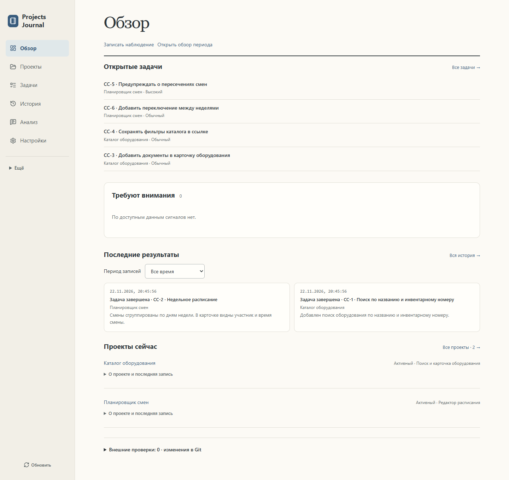

# Dmitry Afonasenko

[Telegram · @dmitry_tbp](https://t.me/dmitry_tbp)

## Applications

### Trajectory

A personal journal for daily notes, weekly and monthly reviews, and exploring changes over time. It works offline and syncs records across devices.

[Open the app](https://trajectory-life.ru) · [Source code](https://github.com/Dmitryaf/trajectory-life)

Vue 3 · TypeScript · Pinia · Dexie · Supabase

### Inbox Point

A customer messaging service. Customers write through Telegram or VK, staff reply in Telegram, and answers return to the original conversation. A web interface lets staff manage schedules, prices, and FAQs, and check the service's status.

[Source code](https://github.com/Dmitryaf/inbox-point)

Java · Spring Boot · SQLite · React · TypeScript

### Dry Run

An interview preparation app for software development, QA, infrastructure, data, and other IT roles. Build a study program from the question bank, your materials, and project reviews. Practice short or full interviews, revisit difficult questions, and explore your own projects through interactive maps and code examples.

Interviews, question bank, practice, project views, and mobile

Nuxt 4 · Vue 3 · TypeScript · Pinia · Nitro · SQLite

### Projects Journal

A local development journal for project goals, tasks, results, decisions, and reviews. Each project has a history of what happened and why. Use selected project context to discuss decisions and next steps with Codex.

[Source code](https://github.com/Dmitryaf/projects-journal)

React · TypeScript · Java · Spring Boot · SQLite
