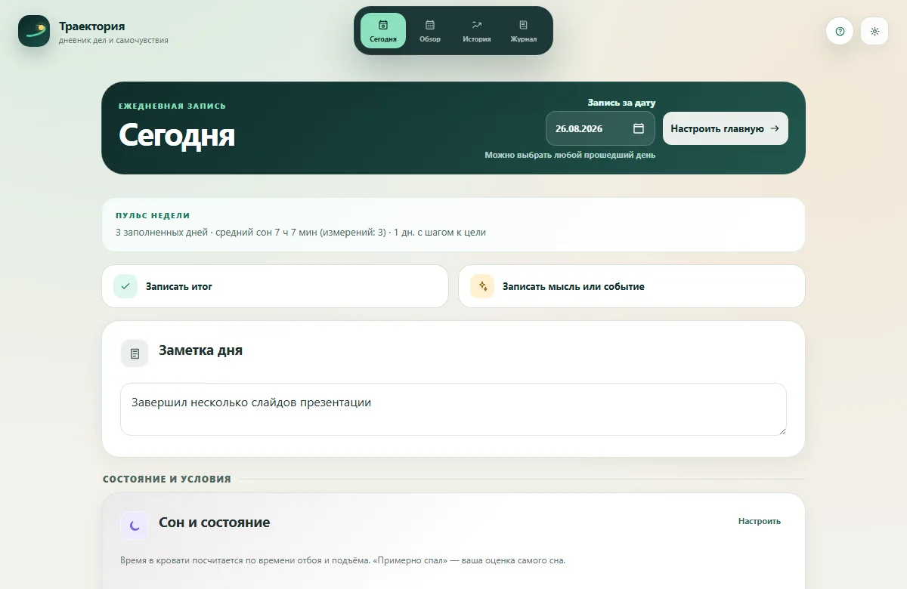
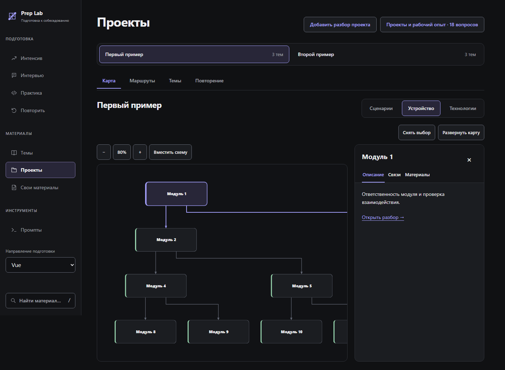
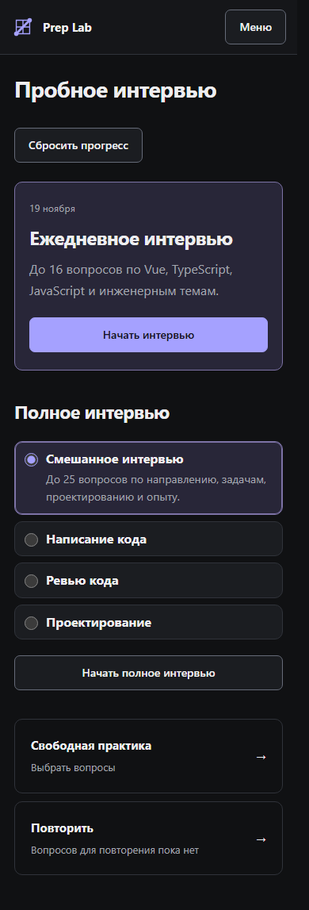
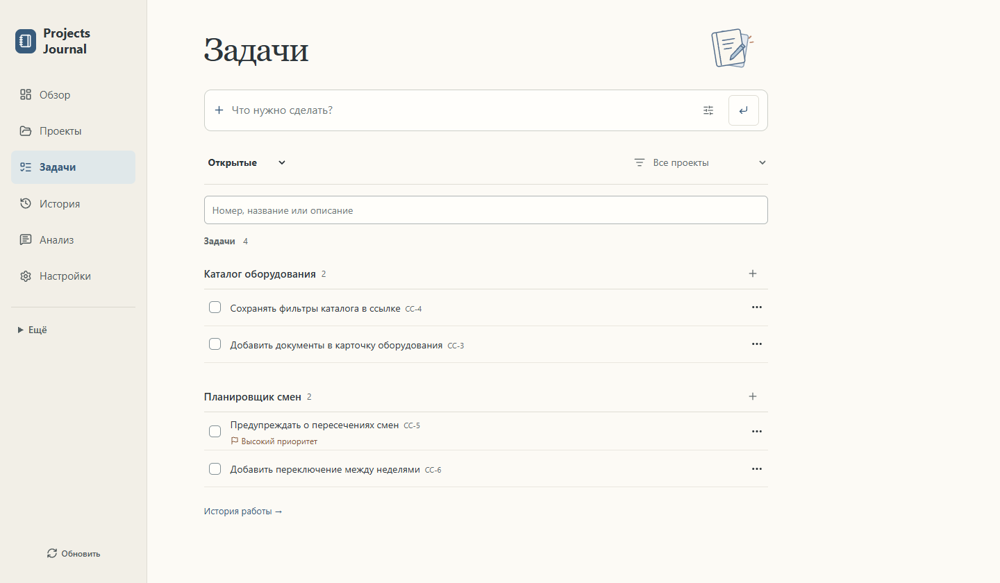

# Dmitry Afonasenko

[Telegram · @dmitry_tbp](https://t.me/dmitry_tbp)

## Applications

### Trajectory

A personal journal for daily notes, weekly and monthly reviews, and exploring changes over time. It works offline and syncs records across devices.

[Open the app](https://trajectory-life.ru) · [Source code](https://github.com/Dmitryaf/trajectory-life)

Vue 3 · TypeScript · Pinia · Dexie · Supabase

### Inbox Point

A customer messaging service. Customers write through Telegram or VK, staff reply in Telegram, and answers return to the original conversation. A web interface lets staff manage schedules, prices, and FAQs, and check the service's status.

[Source code](https://github.com/Dmitryaf/inbox-point)

React · TypeScript · Node.js · Fastify · SQLite

### Prep Lab

Interview preparation built around your projects and study materials. Create focused study programs, run mock interviews, practice coding and code review, revisit difficult questions, and explore project architecture through interactive maps. The built-in collection covers frontend, backend, QA, infrastructure, data, and other professional tracks.

A unified dark interface adapts to desktop and mobile, with shared navigation, search, and reading views for notes and code.

Interviews, coding practice, project map, code, and mobile interface

Nuxt 4 · Vue 3 · TypeScript · Pinia · SQLite

### Control Center

A local app for projects, tasks, decisions, and weekly or monthly reviews. It keeps work history and supports project discussions with Codex, explicit proposal acceptance, and optional review schedules.

[Source code](https://github.com/Dmitryaf/control-center)

React · TypeScript · Node.js · Express · SQLite

