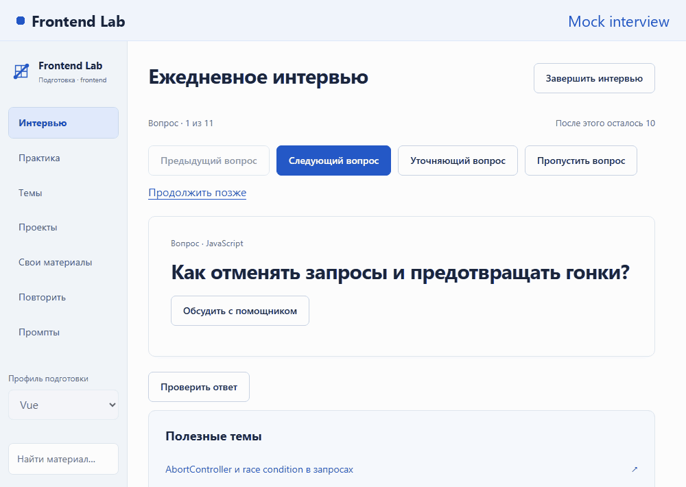
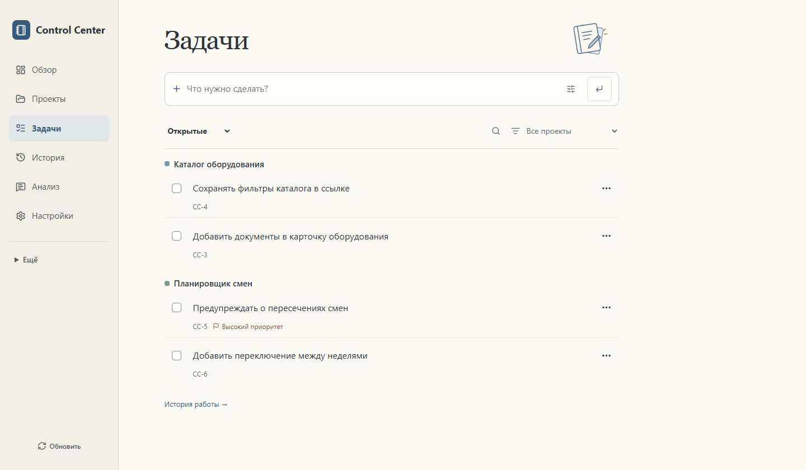

# Dmitry Afonasenko

[Telegram · @dmitry_tbp](https://t.me/dmitry_tbp)

## Applications

### Trajectory

A personal journal for daily notes, weekly and monthly reviews, and exploring changes over time. It works offline and syncs records across devices.

[Open the app](https://trajectory-life.ru) · [Source code](https://github.com/Dmitryaf/trajectory-life)

Vue 3 · TypeScript · Pinia · Dexie · Supabase

### Inbox Point

A customer messaging service. Customers write through Telegram or VK, staff reply in Telegram, and answers return to the original conversation. A web interface lets staff manage schedules, prices, and FAQs, and check the service's status.

[Source code](https://github.com/Dmitryaf/inbox-point)

React · TypeScript · Node.js · Fastify · SQLite

### Frontend Lab

A self-hosted app for frontend interview prep. Run mock interviews, work through coding and code review exercises, and revisit questions you found difficult. You can also add your own Markdown notes.

[Source code](https://github.com/Dmitryaf/frontend-lab)

Nuxt 4 · Vue 3 · TypeScript · Pinia · SQLite

### Control Center

A local app for tracking projects, tasks, and decisions. Review a week across several projects by seeing what was completed, which decisions were made, and what still needs attention.

[Source code](https://github.com/Dmitryaf/control-center)

React · TypeScript · Node.js · Express · SQLite
