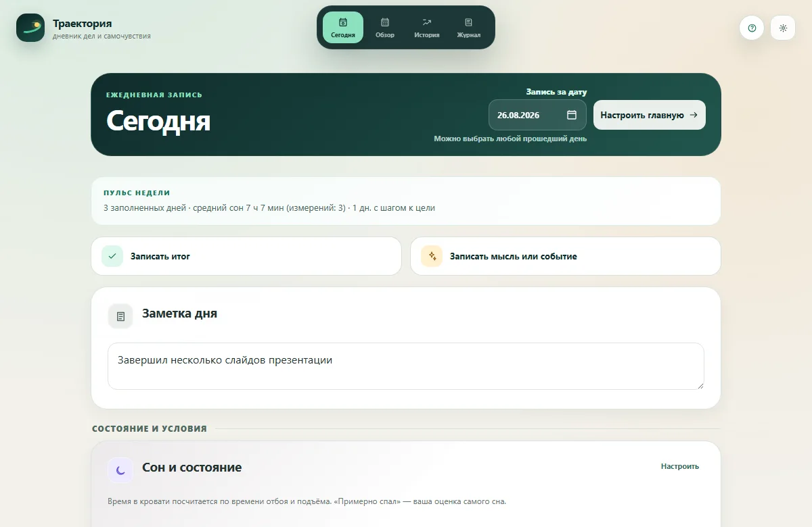
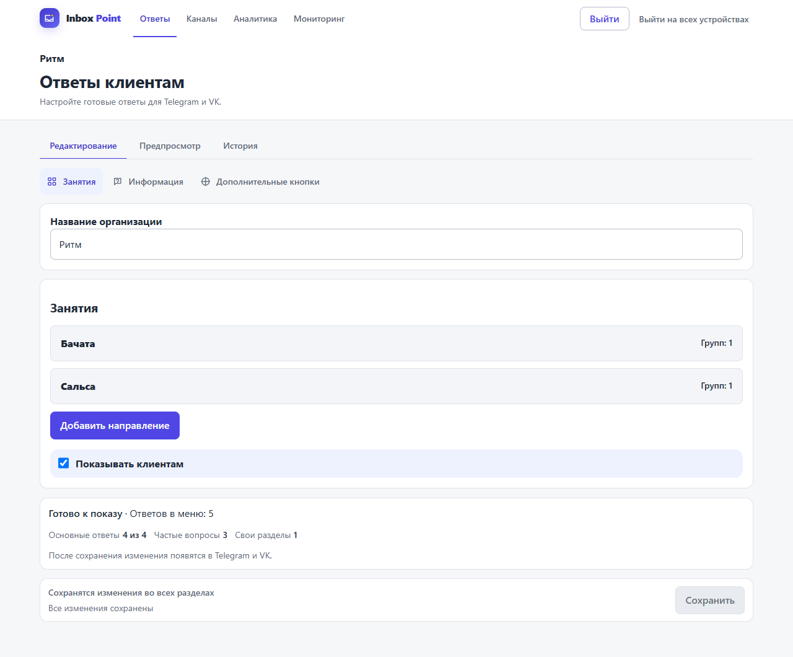
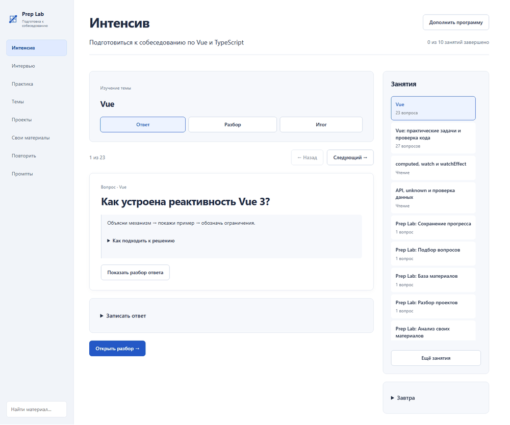
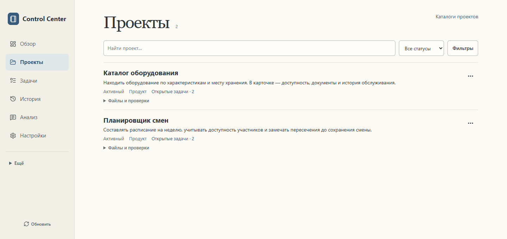

# Dmitry Afonasenko

[Telegram · @dmitry_tbp](https://t.me/dmitry_tbp)

## Applications

### Trajectory

A personal journal for daily notes, weekly and monthly reviews, and exploring changes over time. It works offline and syncs records across devices.

[Open the app](https://trajectory-life.ru) · [Source code](https://github.com/Dmitryaf/trajectory-life)

Vue 3 · TypeScript · Pinia · Dexie · Supabase

### Inbox Point

A customer messaging service. Customers write through Telegram or VK, staff reply in Telegram, and answers return to the original conversation. A web interface lets staff manage schedules, prices, and FAQs, and check the service's status.

[Source code](https://github.com/Dmitryaf/inbox-point)

React · TypeScript · Node.js · Fastify · SQLite

### Prep Lab

Interview preparation built around your own projects and study materials. Create focused study programs, run mock interviews, practice coding, and explore project architecture through interactive maps. The built-in collection covers frontend topics; your own materials can cover other fields.

[Source code](https://github.com/Dmitryaf/prep-lab)

Nuxt 4 · Vue 3 · TypeScript · Pinia · SQLite

### Control Center

A local app for projects, tasks, decisions, and weekly or monthly reviews. It keeps work history and supports project discussions with Codex, explicit proposal acceptance, and optional review schedules.

[Source code](https://github.com/Dmitryaf/control-center)

React · TypeScript · Node.js · Express · SQLite
