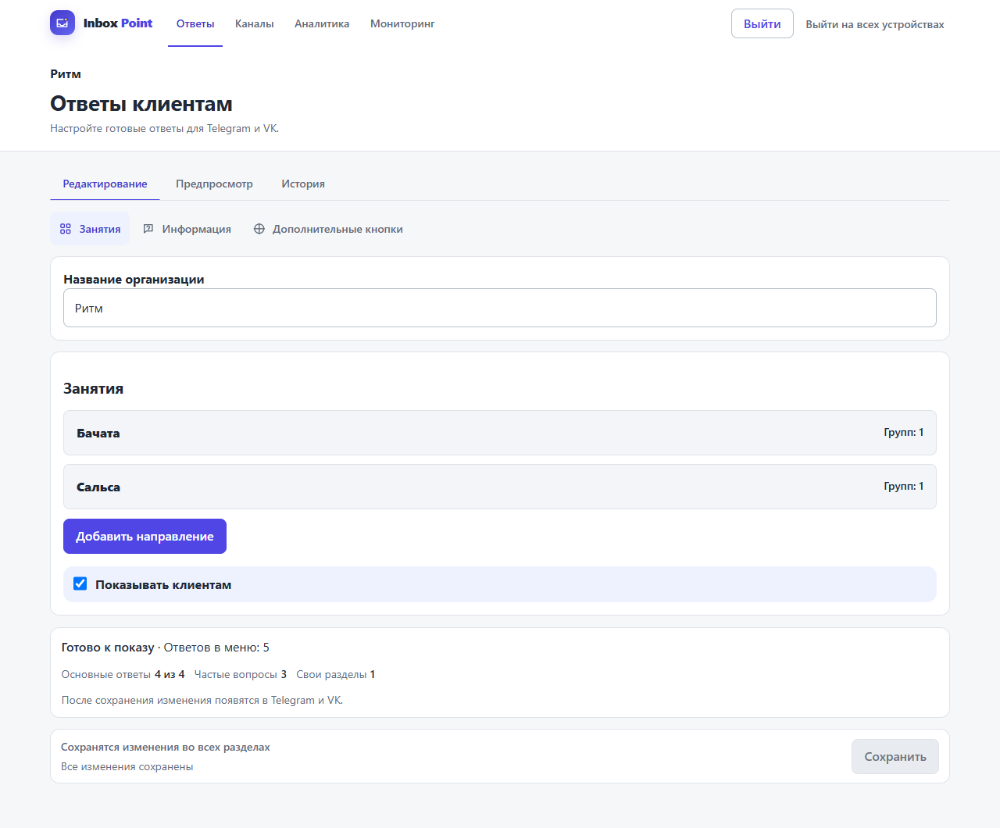
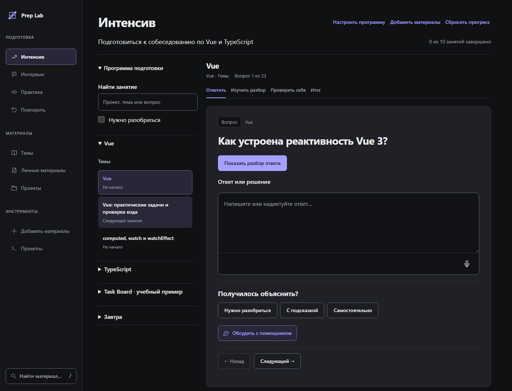
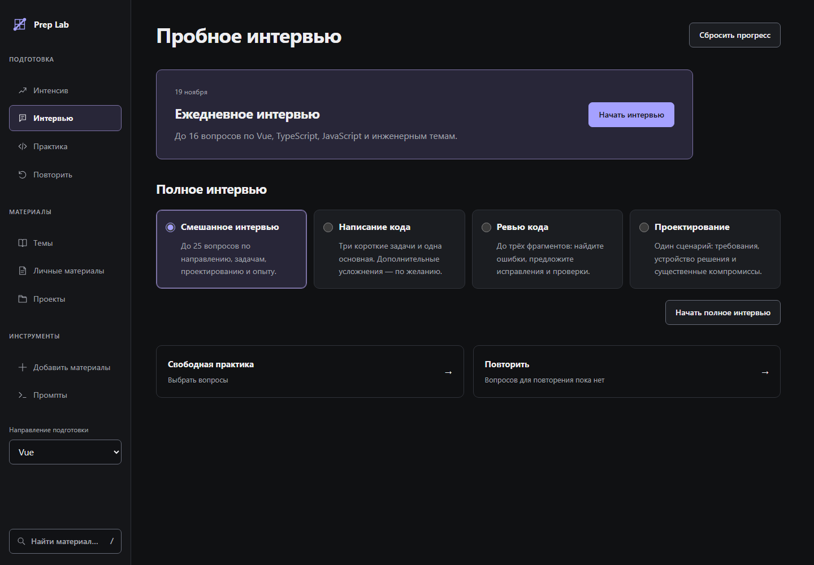
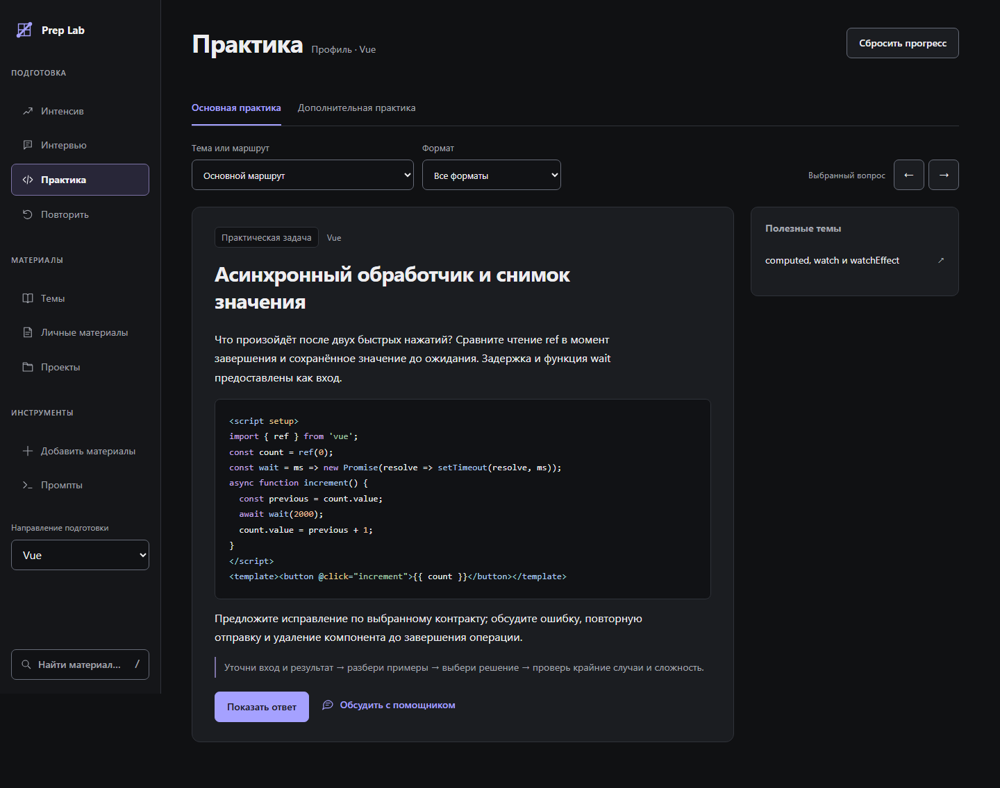
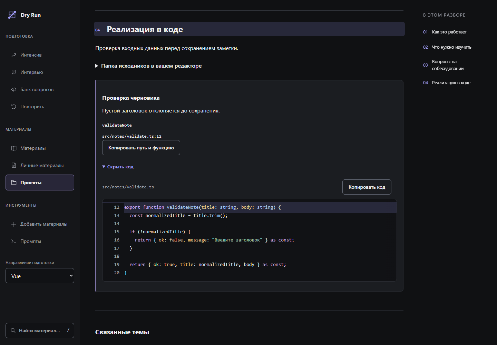
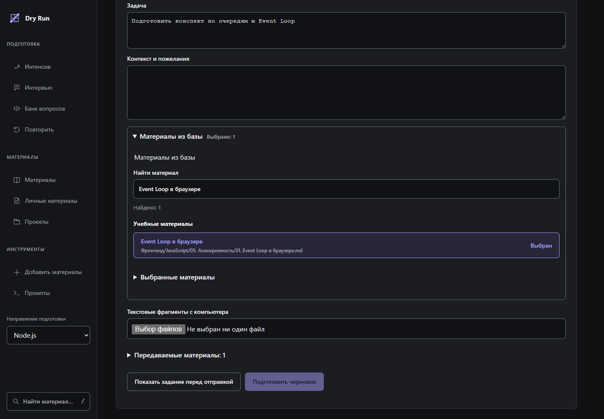

# Dmitry Afonasenko

[Telegram · @dmitry_tbp](https://t.me/dmitry_tbp)

## Applications

### Trajectory

A personal journal for daily notes, weekly and monthly reviews, and exploring changes over time. It works offline and syncs records across devices.

[Open the app](https://trajectory-life.ru) · [Source code](https://github.com/Dmitryaf/trajectory-life)

Vue 3 · TypeScript · Pinia · Dexie · Supabase

### Inbox Point

A customer messaging service. Customers write through Telegram or VK, staff reply in Telegram, and answers return to the original conversation. A web interface lets staff manage schedules, prices, and FAQs, and check the service's status.

[Source code](https://github.com/Dmitryaf/inbox-point)

React · TypeScript · Node.js · Fastify · SQLite

### Prep Lab

Prep Lab helps you prepare for interviews with focused study plans, short practice sessions, and full mock interviews. The question bank covers 37 tracks across software development, QA, infrastructure, data, and other IT roles.

Each interview shows the track and topic alongside the question. Write an answer, compare it with the criteria, and revisit difficult questions on a review schedule. Interactive maps connect project scenarios, modules, and code examples.

Interviews, question bank, practice, project views, and mobile

Nuxt 4 · Vue 3 · TypeScript · Pinia · SQLite

### Control Center

A local app for projects, tasks, decisions, and weekly or monthly reviews. It keeps work history and supports project discussions with Codex, explicit proposal acceptance, and optional review schedules.

[Source code](https://github.com/Dmitryaf/control-center)

React · TypeScript · Node.js · Express · SQLite

